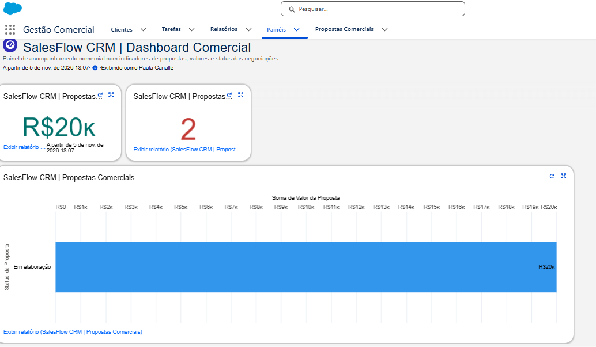

# ☁️ SalesFlow CRM

## 📌 Sobre o projeto

O SalesFlow CRM é um projeto prático desenvolvido na plataforma Salesforce para simular a gestão de clientes e propostas comerciais, com foco em automação de processos, organização de dados e análise comercial.

O projeto faz parte do meu portfólio de estudos e desenvolvimento profissional em Salesforce Administration.

## 🚀 Funcionalidades desenvolvidas

- Cadastro e gerenciamento de clientes.
- Cadastro de propostas comerciais.
- Relacionamento Lookup entre Cliente e Proposta Comercial.
- Automação com Salesforce Flow para criação de tarefa de acompanhamento três dias após o cadastro de uma proposta.
- Relatório de propostas comerciais.
- Dashboard Comercial com três componentes para acompanhamento dos resultados.

## 🛠️ Tecnologias e ferramentas

- Salesforce Platform
- Salesforce Flow Builder
- Salesforce Object Manager
- Salesforce Reports & Dashboards
- Git e GitHub para documentação e versionamento

## 📊 Dashboard Comercial

O dashboard apresenta indicadores de valor total das propostas, quantidade de propostas e distribuição por status.

## 🎯 Objetivo

Demonstrar conhecimentos práticos em modelagem de dados, automação declarativa e análise de informações comerciais utilizando Salesforce.

## 🔜 Próximas melhorias

- Adicionar capturas de tela das funcionalidades.
- Expandir os relatórios e indicadores comerciais.
- Documentar os metadados do Salesforce e versioná-los no GitHub.

## 👩‍💻 Autora

Paula Canalle

Projeto desenvolvido para estudos e portfólio profissional em Salesforce.
