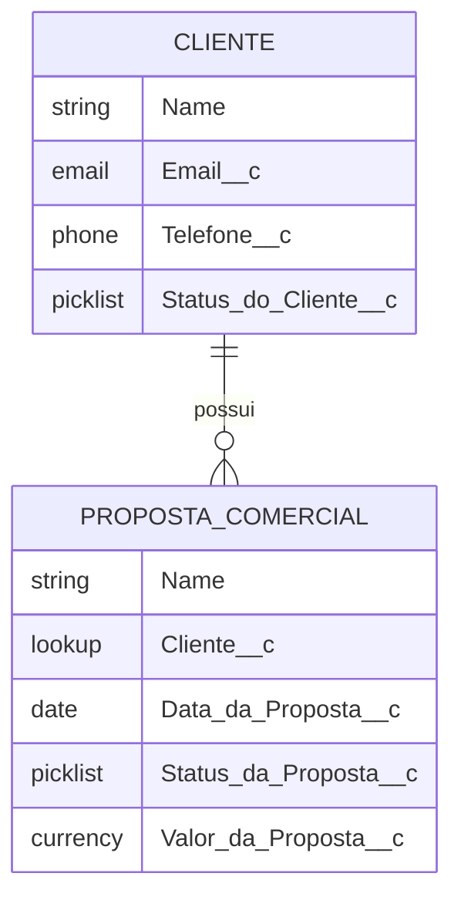

# SalesFlow CRM — Data Model

## 1. Visão geral

O SalesFlow CRM é um projeto prático desenvolvido na plataforma Salesforce, com foco na gestão de clientes, propostas comerciais, automação de processos e análise de indicadores comerciais.

## 2. Arquitetura de dados

O modelo utiliza dois objetos personalizados (Custom Objects), conectados por um relacionamento Lookup.

## 3. Objeto Cliente

- API Name: `Cliente__c`
- Tipo: Custom Object
- Finalidade: cadastro de clientes para acompanhamento de propostas comerciais.

### Dicionário de dados

| Campo | API Name | Tipo |
|---|---|---|
| Nome de Cliente | Name | Text (80) |
| E-mail | Email__c | Email |
| Telefone | Telefone__c | Phone |
| Status do Cliente | Status_do_Cliente__c | Picklist |
| Criado por | CreatedById | Lookup |
| Modificado pela última vez por | LastModifiedById | Lookup |
| Proprietário | OwnerId | Lookup |

### Status do Cliente

- Em prospecção (valor padrão)
- Ativo
- Inativo

## 4. Objeto Proposta Comercial

- API Name: `Proposta_Comercial__c`
- Tipo: Custom Object
- Finalidade: armazenamento e acompanhamento das propostas comerciais vinculadas aos clientes.

### Dicionário de dados

| Campo | API Name | Tipo |
|---|---|---|
| Cliente | Cliente__c | Lookup |
| Nome de Proposta Comercial | Name | Text (80) |
| Data da Proposta | Data_da_Proposta__c | Date |
| Status da Proposta | Status_da_Proposta__c | Picklist |
| Valor da Proposta | Valor_da_Proposta__c | Currency (16,2) |
| Criado por | CreatedById | Lookup |
| Modificado pela última vez por | LastModifiedById | Lookup |
| Proprietário | OwnerId | Lookup |

### Status da Proposta

- Em elaboração (valor padrão)
- Enviada
- Em negociação
- Aprovada
- Recusada

## 5. Relacionamento entre objetos

- Tipo: Lookup Relationship
- Cardinalidade: One-to-Many (1:N)
- Objeto principal: Cliente
- Objeto relacionado: Proposta Comercial
- Campo de relacionamento: Cliente__c
- Child Relationship Name: Propostas_Comerciais
- Preenchimento obrigatório: Sim
- Exclusão de clientes com propostas vinculadas: Bloqueada
- Filtro de pesquisa: Não configurado

## 6. Integridade de dados

O modelo garante que:

- Toda proposta comercial esteja vinculada a um cliente.
- Clientes com propostas vinculadas não sejam excluídos.
- Os status comerciais sejam padronizados por meio de Picklists.
- Os valores financeiros utilizem campos do tipo Currency.

## 7. Configurações adicionais

Ambos os objetos possuem:

- Relatórios habilitados.
- Rastreamento de atividades habilitado.
- Rastreamento de histórico de campos habilitado.
- Status de implantação ativo.

## 8. Competências Salesforce aplicadas

- Salesforce Administration
- Data Modeling
- Custom Objects
- Custom Fields
- Lookup Relationships
- Picklist Configuration
- Data Integrity
- Declarative Configuration
- Technical Documentation
- Git e GitHub

---

Projeto desenvolvido para fins de aprendizado e portfólio profissional.

Última atualização: 24/11/2026.
